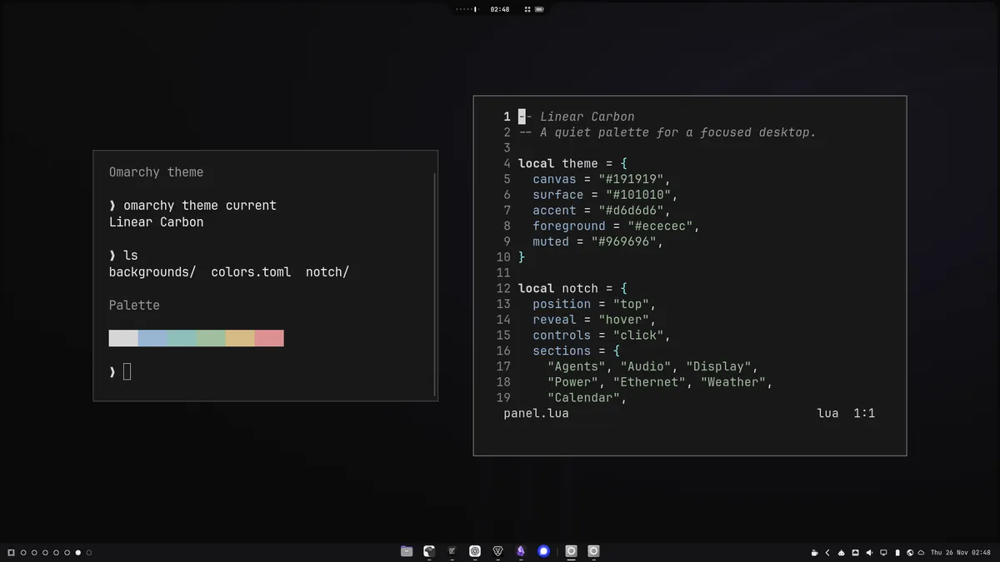

# Linear Carbon

An Omarchy theme with charcoal surfaces, a silver accent, and muted syntax
colors. It includes a matching wallpaper. Omarchy uses `colors.toml` to generate
colors for supported apps, including terminals, Neovim, VS Code, and btop.
The notch reads that same palette.



## Install

From this directory on an Omarchy workstation, copy the theme files into
Omarchy's themes directory and select Linear Carbon. This updates local files
with matching names.

```sh
theme_dir="$HOME/.config/omarchy/themes/linear-carbon"
mkdir -p "$theme_dir"
cp -R backgrounds notch chromium.theme colors.toml icons.theme shell.toml "$theme_dir/"
omarchy theme set "Linear Carbon"
```

## Enable the optional notch

The notch is a top panel that runs alongside the standard Omarchy bar.
It shows workspaces, the clock, the window layout, and battery level when
available. Hover over the clock for the date or click the notch to open
Agents, Audio, Display, Power, Ethernet, Weather, and Calendar.

With Quickshell and Python 3.11 or newer installed, run these commands once
from this directory.

```sh
omarchy hook install theme-set notch/linear-carbon-notch
omarchy hook install post-boot notch/linear-carbon-notch
omarchy theme set "Linear Carbon"
```

Switching themes stops the notch. Selecting Linear Carbon again starts it,
including when logging into an Omarchy session with Linear Carbon active.

## Use the bottom-attached app launcher

Run `notch/setup-app-launcher` once to install the dock clone. It updates
Omarchy's app grid to open as a compact search box on Linear Carbon. Type
to widen the launcher and show matches, or choose **All apps** to browse.
The stock layout is used with other themes. The **Apps** entry points and
existing Super keybindings continue to call Omarchy's launcher.

Run the setup script again after an Omarchy update to refresh the clone.

## Use the notification corner for arrivals

Run `notch/setup-notification-corner` once from this directory. It creates a
local clone of Omarchy's notification plugin so the Linear Carbon corner can
show new arrivals and the history in the same place. The clone uses Omarchy's
regular presentation on other themes. Run the setup script again after an
Omarchy update to refresh the clone.

## License

[MIT](LICENSE)
